# Лабораторная работа №6

## Система контроля версий

**Дисциплина:** Основы программирования  
**Выполнил:** студент группы 4516 Чупырь Д.А.  
**Преподаватель:** Рыжов К.Ю.  
**ГУАП, кафедра №41**  
**Дата:** 13.11.2026

## Цель работы

Изучить базовые возможности системы контроля версий Git, получить опыт работы с локальным и удалённым репозиторием.

## Ход работы

### 1 Учётная запись GitHub

Для работы использована учётная запись `zxcmisha` на GitHub.

### 2 Создание копии репозитория

Создан fork учебного репозитория [Kurtyanik/LR6](https://github.com/Kurtyanik/LR6) в личном хранилище [zxcmisha/LR6](https://github.com/zxcmisha/LR6). В fork скопированы обе исходные ветки: `master` и `branch1`.

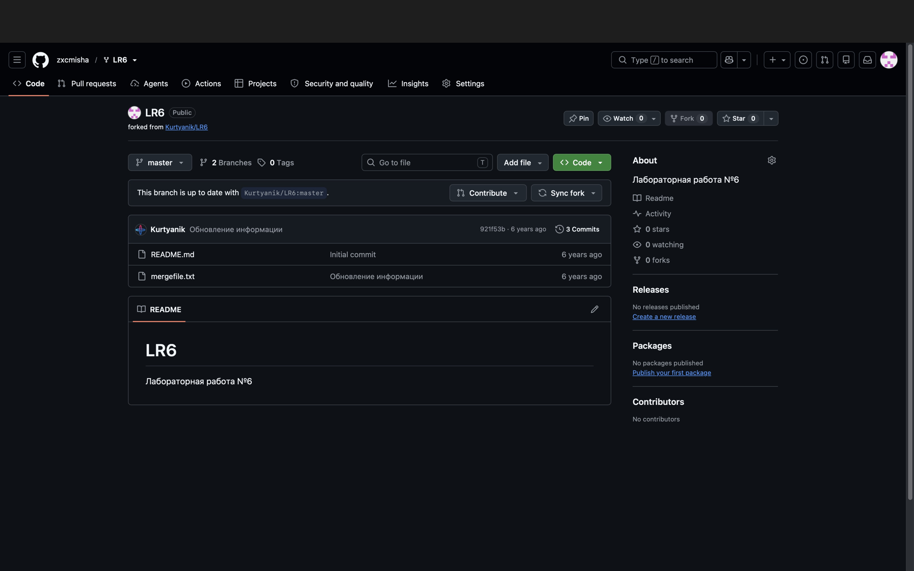

*Рисунок 1 — копия учебного репозитория в личном хранилище.*

### 3 Установка Git

Git установлен через Homebrew командой `brew install git`. После установки команда `git --version` показала версию `2.56.1`.

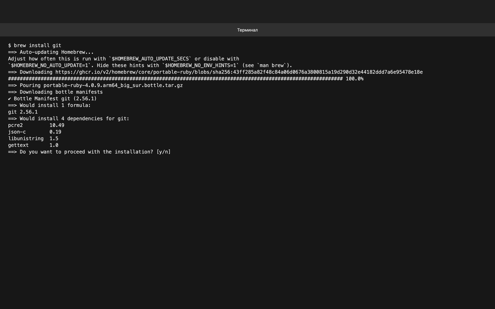

*Рисунок 2 — запуск установки Git через Homebrew.*

### 4 Настройка клиента

В настройках Git заданы имя автора `4516 Чупырь Д.А.` и email `volv_chokopay@mail.ru`. Значения проверены командами `git config --global --get user.name` и `git config --global --get user.email`.

### 5 Клонирование личного репозитория

Личный репозиторий клонирован по SSH командой `git clone git@github.com:zxcmisha/LR6.git LR6`. Затем командой `cd LR6` выполнен переход в папку проекта. В списке веток присутствуют `origin/master` и `origin/branch1`.

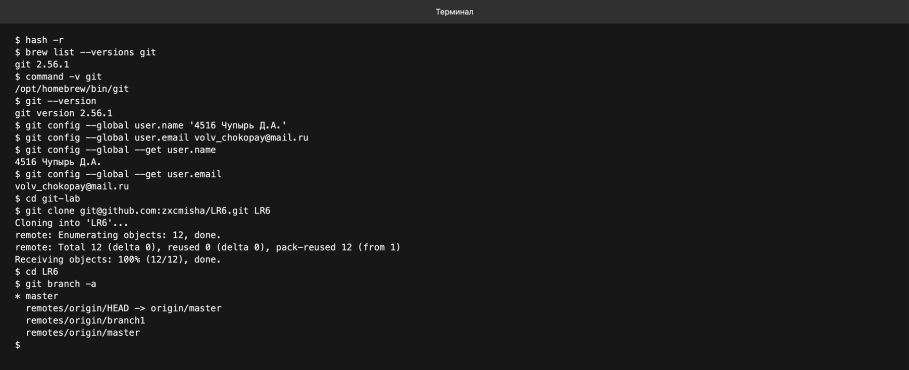

*Рисунок 3 — версия Git, настройка имени и email, клонирование репозитория.*

### 6 Добавление файла через GitHub и получение изменений

Через интерфейс GitHub в ветке `master` создан файл `github-file.txt`. Коммит `45819dc` имеет комментарий «Добавлен файл github-file.txt».

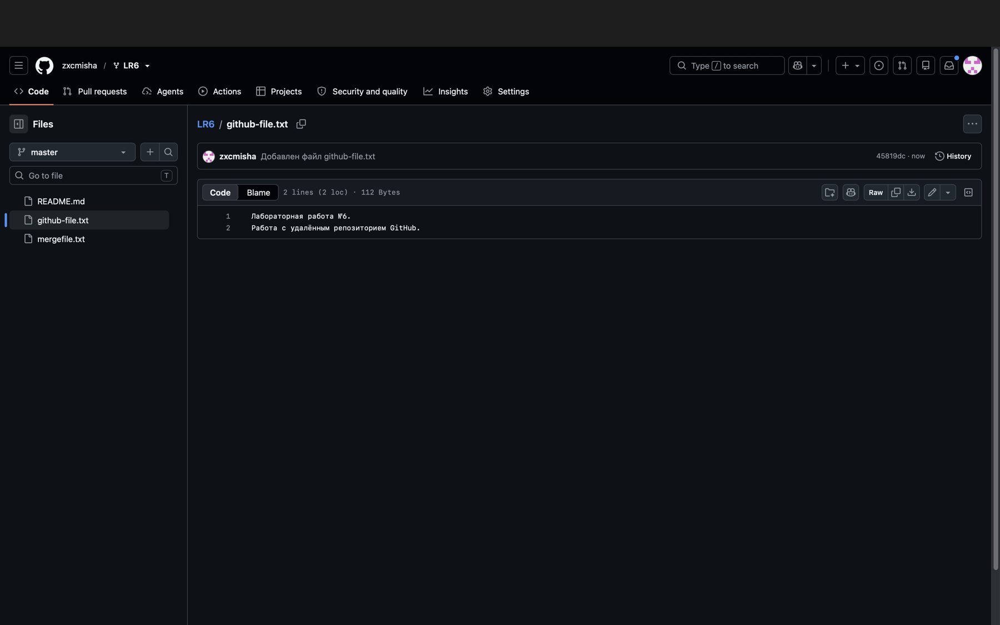

*Рисунок 4 — файл, добавленный через веб-интерфейс GitHub.*

Командой `git pull --ff-only` изменение получено в локальную копию. Выполнено обновление от `921f53b` до `45819dc`. Содержимое файла проверено командой `cat github-file.txt`.

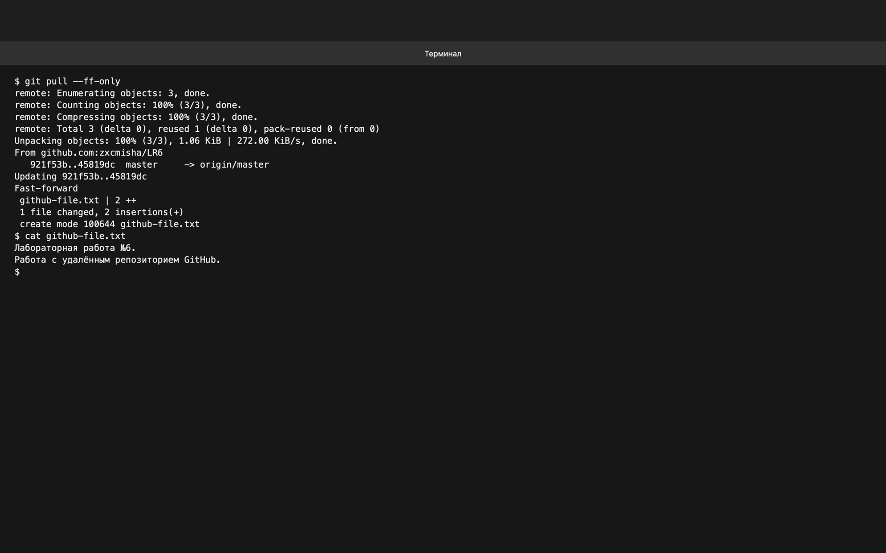

*Рисунок 5 — получение файла из удалённого репозитория.*

### 7 История операций в ветках

Из `origin/branch1` создана локальная ветка `branch1`. История каждой ветки просмотрена отдельно командами `git log master --oneline` и `git log branch1 --oneline`.

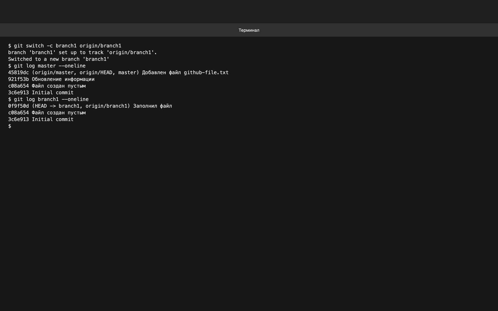

*Рисунок 6 — история master и branch1.*

### 8 Последние изменения

Команда `git show --oneline master` показала последнее изменение в `master`. Команда `git diff master branch1 -- mergefile.txt` показала различия файла между ветками. В `master` файл заполнен «очень важной информацией», а в `branch1` — «информацией, противоречащей ветке master».

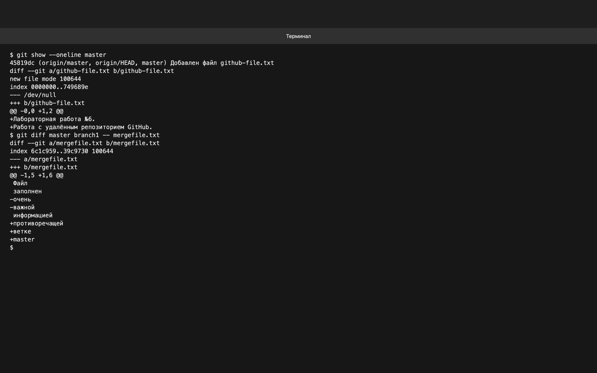

*Рисунок 7 — просмотр последнего коммита и различий между ветками.*

### 9 Слияние и разрешение конфликта

Выполнен переход в `master` и вызвана команда `git merge branch1`. Возник конфликт содержимого `mergefile.txt`. Статус файла — `UU`. Конфликтующие участки обозначены маркерами `<<<<<<< HEAD`, `=======` и `>>>>>>> branch1`.

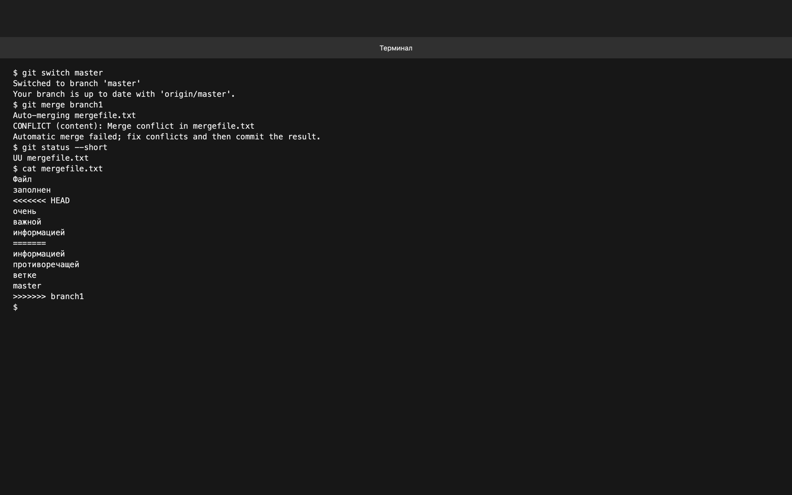

*Рисунок 8 — сообщение Git о конфликте в mergefile.txt.*

Файл `mergefile.txt` открыт в Visual Studio Code. В редакторе просмотрены конфликтующие участки обеих веток.

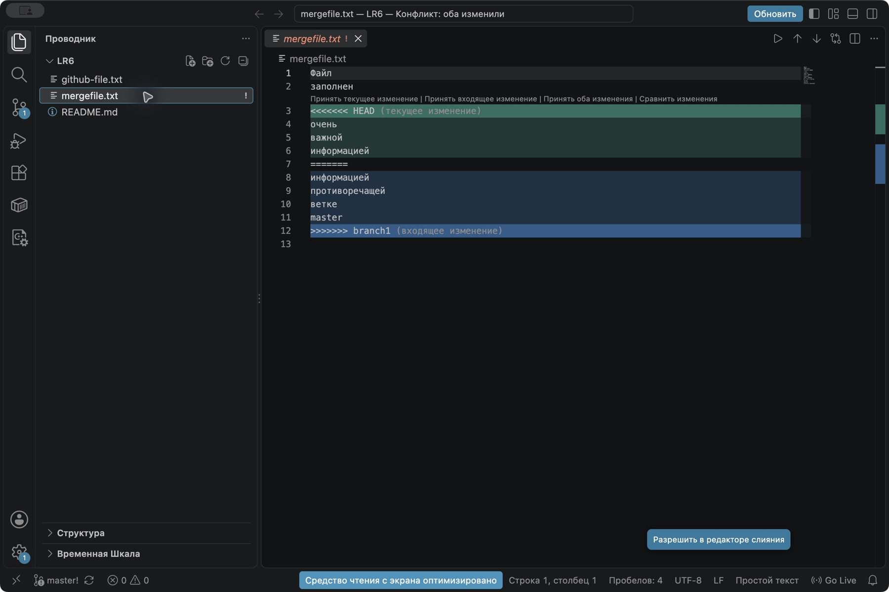

*Рисунок 9 — конфликтующие участки mergefile.txt в Visual Studio Code.*

В Visual Studio Code удалены маркеры конфликта и согласовано итоговое содержимое. Изменения сохранены в редакторе:

```text
Файл
заполнен
очень
важной
информацией.
Противоречие между ветками master и branch1 устранено.
```

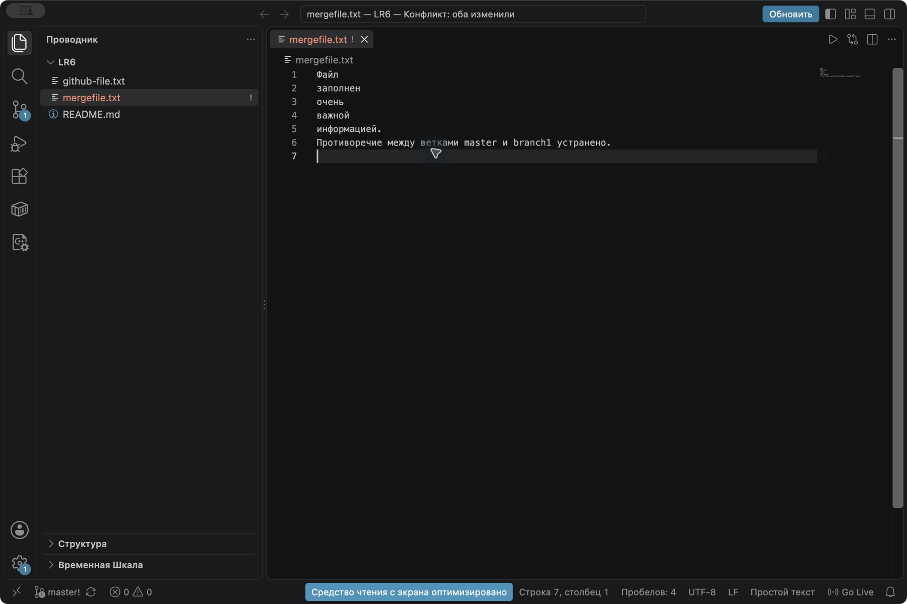

*Рисунок 10 — сохранённое разрешение конфликта в Visual Studio Code.*

Файл добавлен в индекс командой `git add mergefile.txt`. Слияние завершено коммитом `d1008fc` «Разрешён конфликт при слиянии branch1 в master».

### 10 Удаление побочной ветки

После успешного слияния команда `git branch -d branch1` удалила локальную ветку `branch1`. Её изменения сохранились в истории `master`.

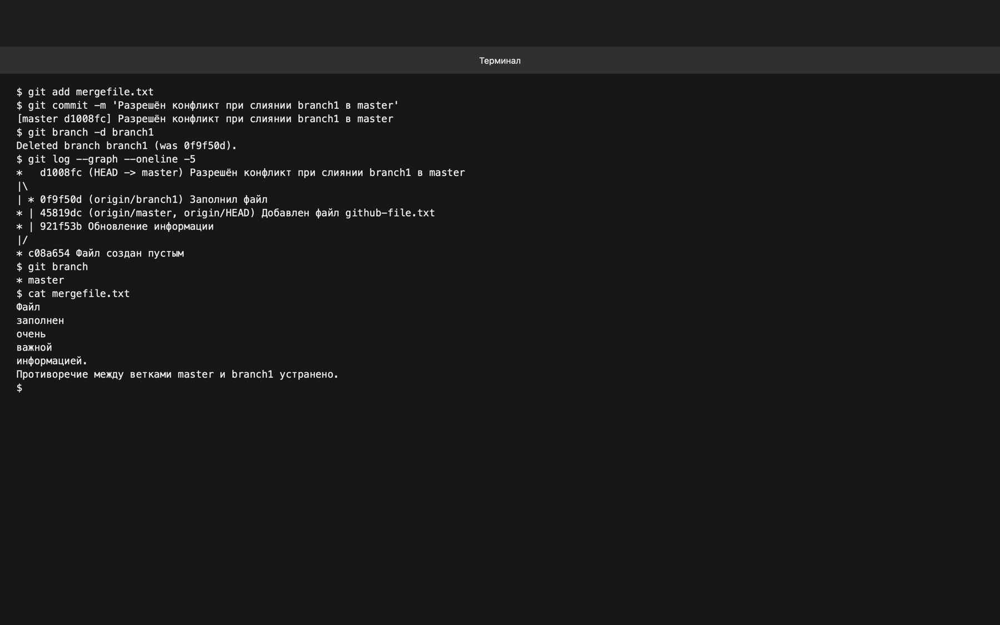

*Рисунок 11 — граф слияния, список локальных веток и итоговый файл.*

### 11 Фиксация изменений

В Visual Studio Code в `mergefile.txt` последовательно внесены три изменения. После каждой правки файл сохранён в редакторе, добавлен в индекс командой `git add mergefile.txt` и зафиксирован отдельным коммитом с комментарием:

| Коммит | Комментарий |
| --- | --- |
| `0930cc9` | Добавлено описание слияния |
| `d2eb5b4` | Добавлена информация о branch1 |
| `da1bdca` | Добавлена проверочная строка |

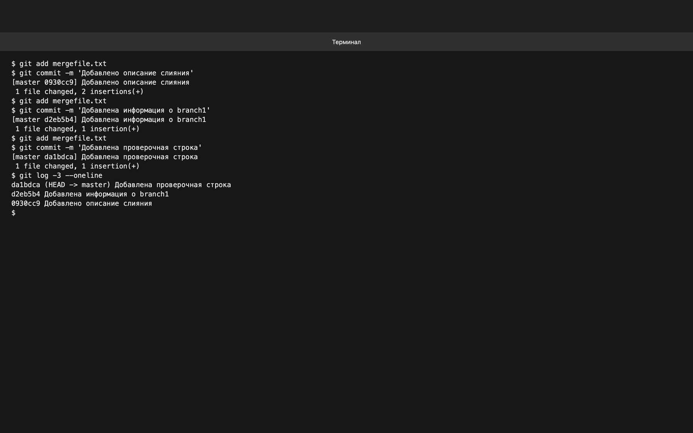

*Рисунок 12 — три изменения с отдельными комментариями.*

### 12 Откат коммита

Команда `git revert --no-edit HEAD` отменила последний коммит `da1bdca`. Создан коммит `e3ff050`. Проверочная строка удалена, содержимое файла соответствует версии `d2eb5b4`. Исходный и отменяющий коммиты сохранены в истории.

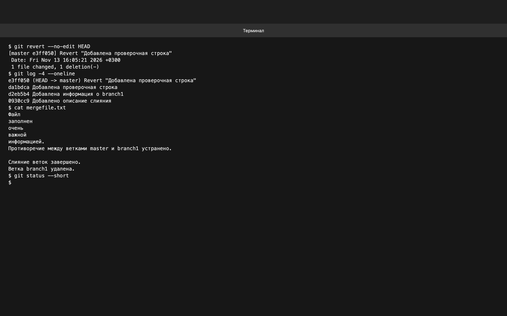

*Рисунок 13 — отмена последнего изменения и проверка результата.*

### 13 Ветка для отчёта

Командой `git switch -c report` создана ветка `report`.

### 14 Оформление отчёта

Отчёт оформлен в `README.md` с использованием Markdown. Снимки экрана находятся в папке `screenshots`. При оформлении отчёта изменения фиксировались отдельными коммитами.

### 15 Форматированная история

История получена командой:

```bash
git log --all --date=short --pretty=format:"%h | %ad | %an | %s"
```

Формат: сокращённый хэш, дата, имя автора и комментарий. История и лог команд приведены перед финальной фиксацией отчёта.

```text
8d8d535 | 2026-11-13 | 4516 Чупырь Д.А. | Добавлены снимки и лог команд
99eca44 | 2026-11-13 | 4516 Чупырь Д.А. | Начато оформление отчёта
e3ff050 | 2026-11-13 | 4516 Чупырь Д.А. | Revert "Добавлена проверочная строка"
da1bdca | 2026-11-13 | 4516 Чупырь Д.А. | Добавлена проверочная строка
d2eb5b4 | 2026-11-13 | 4516 Чупырь Д.А. | Добавлена информация о branch1
0930cc9 | 2026-11-13 | 4516 Чупырь Д.А. | Добавлено описание слияния
d1008fc | 2026-11-13 | 4516 Чупырь Д.А. | Разрешён конфликт при слиянии branch1 в master
45819dc | 2026-11-13 | zxcmisha | Добавлен файл github-file.txt
921f53b | 2020-11-21 | Kurtyanik | Обновление информации
0f9f50d | 2020-11-21 | Kurtyanik | Заполнил файл
c08a654 | 2020-11-21 | Kurtyanik | Файл создан пустым
3c6e913 | 2020-11-21 | Kurtyanik | Initial commit
```

### 16 Отправка изменений на GitHub

Ветки `master` и `report` отправлены на GitHub командой:

```bash
git push -u origin master report
```

Отчёт доступен в [ветке report](https://github.com/zxcmisha/LR6/tree/report).

## Вывод

Git установлен через Homebrew и настроен для работы с GitHub. Выполнены клонирование репозитория, получение изменений, просмотр истории и различий. Конфликт слияния разрешён в Visual Studio Code, побочная ветка удалена. В редакторе внесены три последовательные правки, каждая сохранена отдельным коммитом; последнее изменение отменено через `git revert`. Отчёт подготовлен в Markdown в отдельной ветке.

## Лог команд

```bash
brew install git
brew list --versions git
command -v git
git --version
git config --global user.name '4516 Чупырь Д.А.'
git config --global user.email volv_chokopay@mail.ru
git config --global --get user.name
git config --global --get user.email
git clone git@github.com:zxcmisha/LR6.git LR6
cd LR6
git branch -a
git pull --ff-only
cat github-file.txt
git switch -c branch1 origin/branch1
git log master --oneline
git log branch1 --oneline
git show --oneline master
git diff master branch1 -- mergefile.txt
git switch master
git merge branch1
git status --short
cat mergefile.txt
git add mergefile.txt
git commit -m 'Разрешён конфликт при слиянии branch1 в master'
git branch -d branch1
git log --graph --oneline -5
git branch
cat mergefile.txt
git add mergefile.txt
git commit -m 'Добавлено описание слияния'
git add mergefile.txt
git commit -m 'Добавлена информация о branch1'
git add mergefile.txt
git commit -m 'Добавлена проверочная строка'
git log -3 --oneline
git revert --no-edit HEAD
git log -4 --oneline
cat mergefile.txt
git status --short
git switch -c report
git add README.md
git commit -m 'Начато оформление отчёта'
git add README.md screenshots
git commit -m 'Добавлены снимки и лог команд'
git log --all --date=short --pretty=format:"%h | %ad | %an | %s"
git add README.md
git commit -m 'Добавлена форматированная история'
git push -u origin master report
```
